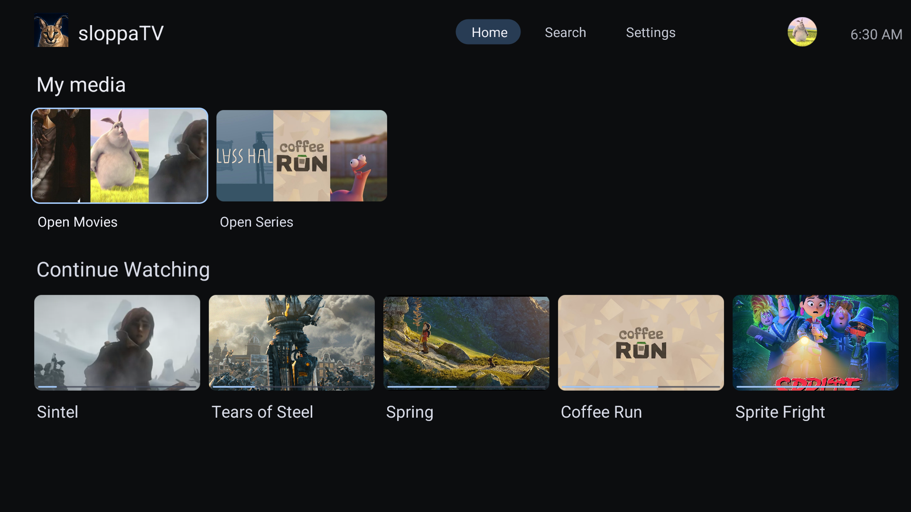
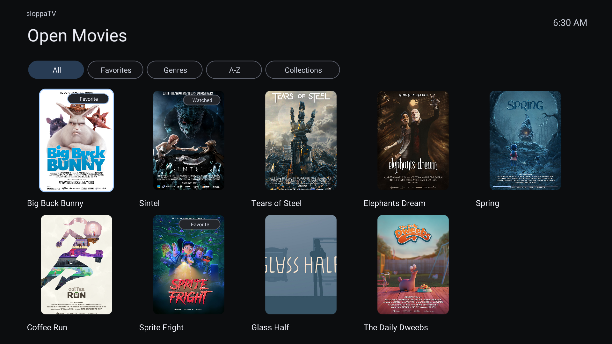
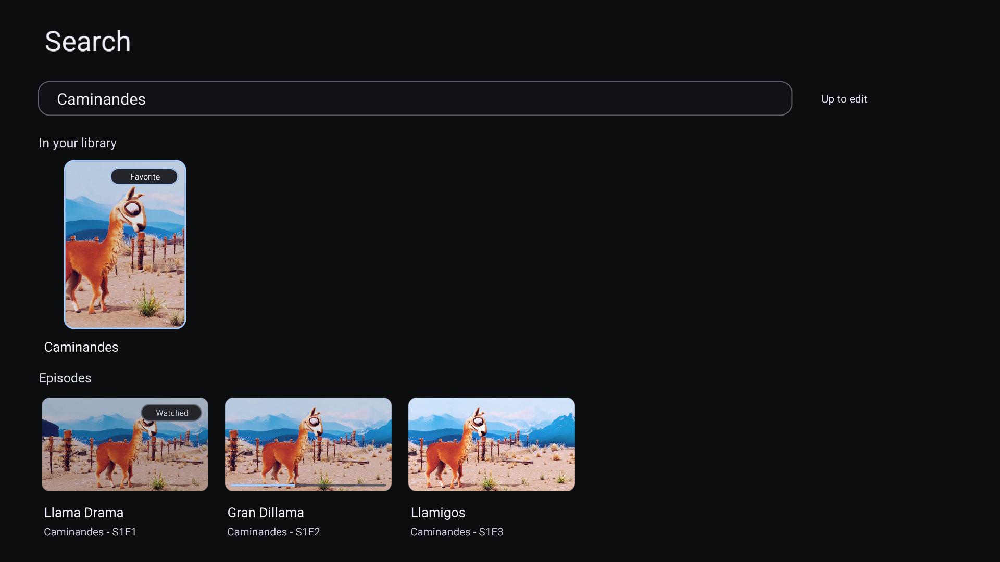
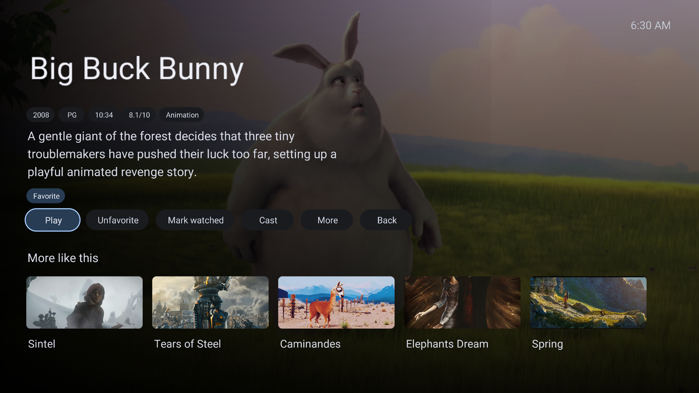
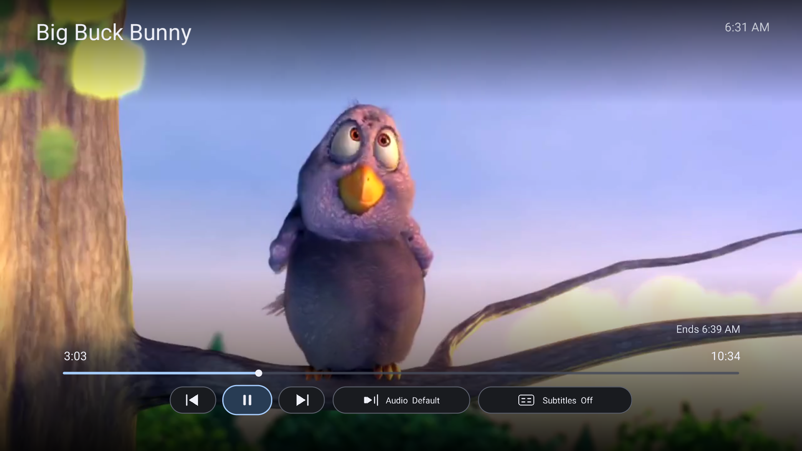
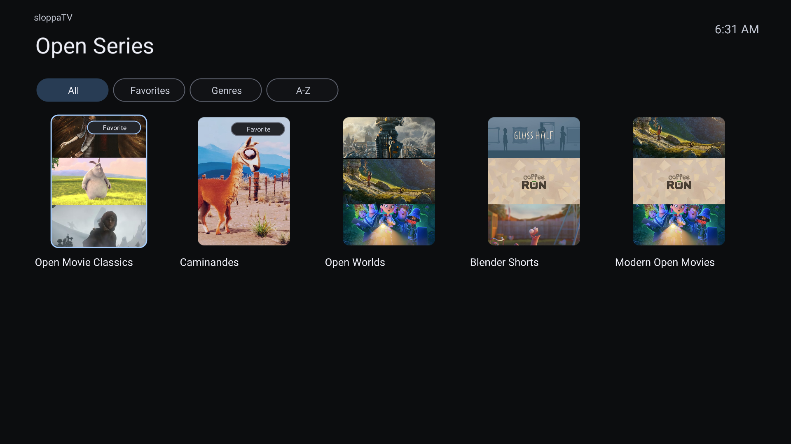
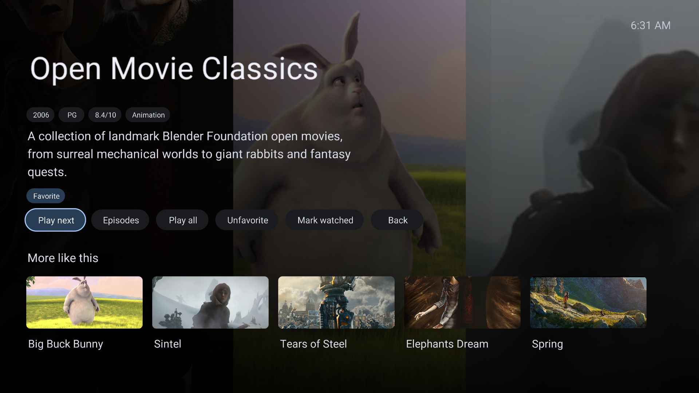
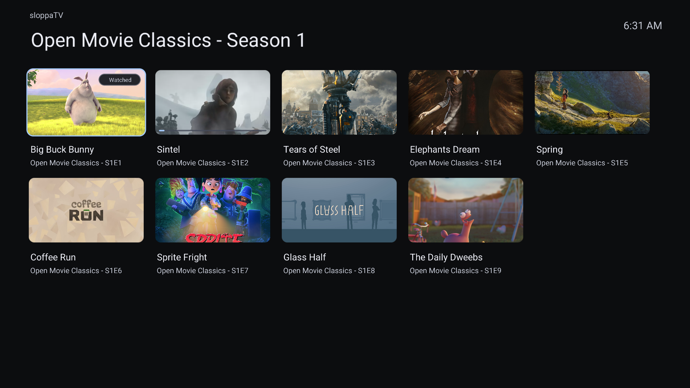

  <h1>sloppaTV</h1>

  
A couch-first Jellyfin client for Android TV.

  

    
    
  

## Screenshots

  
   
  
   
  
   
  
   
  
   
  
   
  
   
  

## License

GPL-3.0-or-later. See [LICENSE](LICENSE).

## Android TV release installation

The baseline `SLOPPATV_VERSION_CODE=18` is for isolated debug/E2E builds, **not** signed
production releases. Android refuses an in-place install if its version code is lower
than the existing app. The release build therefore requires at least
`SLOPPATV_MIN_RELEASE_CODE`, while GitHub Play releases use the CI run number.

For a connected TV, run `python3 tools/install_tv_release.py --serial <adb-serial>`
to build, validate, install and launch `app.sloppatv` without clearing data. The
installer uses the greater of the release floor and the installed version + 1.
Do not launch the separate `app.sloppatv.remuxtest` testing application as the
normal production client.
